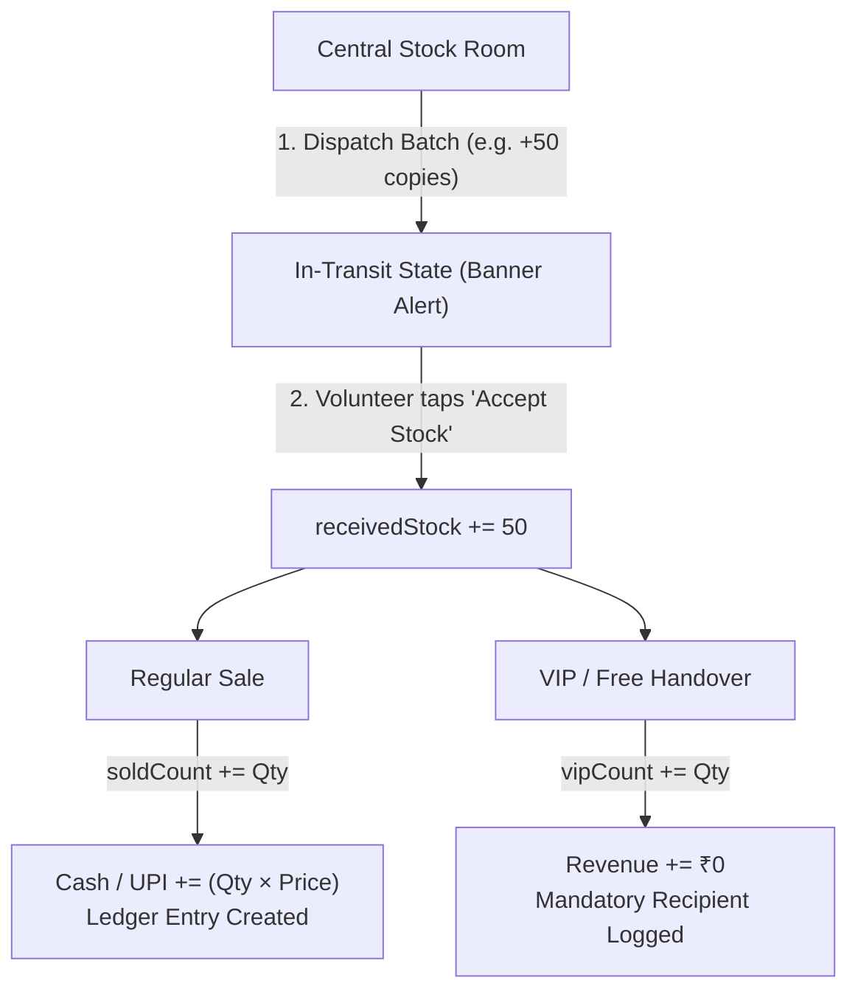

# CounterSync — Counter Statistics Engine & Mathematical Flow

> A technical breakdown of how real-time counter metrics, inventory balances, cash reconciliations, and peer transfers are computed, cached, and synchronized.

---

## 1. Core State Model of a Counter

Every sales counter in CounterSync is represented as an independent accounting entity within the ledger:

```json
{
  "id": "cnt_1a",
  "name": "Counter 01A",
  "volunteers": "Safwan, Rashid",
  "pin": "1101",
  "upiId": "counter1a@upi",
  "receivedStock": 150,     // Total physical copies accepted by this counter
  "soldCount": 42,          // Total copies handed over via verified regular sales + paid pickups
  "vipCount": 3,            // Free/complimentary copies issued
  "cashCollected": 3800,    // Total INR in physical cash
  "upiCollected": 400       // Total INR in digital UPI receipts
}
```

---

## 2. Real-Time Metric Formulas (The Counter Dashboard)

### 2.1 Remaining Stock (The HERO Display)

The remaining inventory displayed on the active counter dashboard is computed using a balanced debit equation:

$$\text{Remaining Stock} = \max\Big(0,\; \text{receivedStock} - \text{soldCount} - \text{vipCount}\Big)$$

* **Low Stock Trigger:** If $\text{Remaining Stock} \le 10$, the UI flags a `LOW STOCK` badge in bold red and activates the rapid replenishment alert button to notify the Central Stock Room.

### 2.2 Total Collection (Live Revenue)

The total revenue generated specifically by that counter:

$$\text{Total Collection} = \text{cashCollected} + \text{upiCollected}$$

* **Cash Channel:** Physical currency collected directly during regular sales or *"Pay on Pickup"* pre-order collections.
* **UPI Channel:** Digital transactions verified through the Dynamic UPI QR scanner modal.

---

## 3. Stock Lifecycle & Event Inflows/Outflows



### 3.1 Two-Way Dispatch Handshake

When the Central Stock Room sends copies, the counter's numbers **do not change immediately**.

1. The dispatch object is saved as `{ accepted: false, status: "IN_TRANSIT" }`.
2. The active counter detects the pending dispatch and renders the amber **"Incoming Stock Transfer"** banner.
3. Once the physical boxes arrive and staff taps **"Accept Stock"**:
   * `accepted = true`, `status = "ACCEPTED"`
   * `counter.receivedStock += dispatch.qty`
   * The remaining inventory increments instantaneously.

### 3.2 Inter-Counter Peer Transfer (Balancing Shelves)

When Counter $A$ hands over 20 copies directly to Counter $B$:

$$\text{receivedStock}_A \leftarrow \text{receivedStock}_A - 20$$
$$\text{receivedStock}_B \leftarrow \text{receivedStock}_B + 20$$

* A transaction of type `PEER_TRANSFER` is logged with timestamps, preserving the global event-wide balance without affecting cash collections.

---

## 4. End-of-Day Physical Cash Reconciliation Formula

At the end of a shift, volunteers use the built-in Denomination Calculator to count physical currency against logged digital receipts:

$$\text{Physical Cash Total} = \sum (\text{Denomination} \times \text{Count})$$

$$\text{Reconciliation Difference} = \text{Physical Cash Total} - \text{counter.cashCollected}$$

| Condition | Status Display | Semantic Color | Meaning |
| :--- | :--- | :--- | :--- |
| $\text{Diff} = 0$ | **Exact Match ✓** | Emerald (`#059669`) | Every logged transaction matches physical cash in the drawer. |
| $\text{Diff} > 0$ | **Surplus (+₹X)** | Amber (`#F59E0B`) | Unlogged sales or extra tip/change retained. |
| $\text{Diff} < 0$ | **Shortage (-₹X)** | Rose (`#E11D48`) | Missing cash, incorrect change returned, or unlogged refund. |

---

## 5. Transaction Void & Cancellation Logic

If a sale is canceled or entered by error:

1. Staff opens the **History** tab and taps **Cancel**.
2. Staff must enter the **Counter PIN** or the **Admin Master PIN**.
3. Once authorized:
   * `tx.isVoided = true`
   * $\text{soldCount} \leftarrow \text{soldCount} - \text{tx.qty}$
   * $\text{cashCollected} \leftarrow \text{cashCollected} - \text{tx.amount}$ (or `upiCollected`)
   * Copies are immediately restored to $\text{Remaining Stock}$ in real time.

---

## 6. Grand Reconciliation in Super Admin View

In the Executive Master Dashboard, all individual counter statistics are aggregated into the **Balanced Ledger**:

$$\text{Grand Total Remaining} = \text{Reserve in Stock Room} + \sum_{\text{all counters}} \text{Remaining Stock}_i$$

$$\text{Total Inflow from Press} \equiv \text{Total Sold} + \text{Total VIP} + \text{Grand Total Remaining}$$

This mathematical identity guarantees that no copies can vanish from the system unaccounted for during high-traffic festival days.
